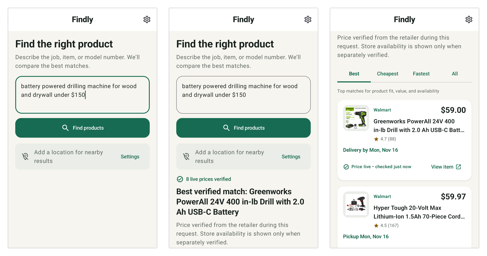

# Findly

Findly turns a natural-language shopping request, like "a battery powered drilling machine for wood and drywall under $150", into a shortlist of live offers from Amazon, Walmart, Home Depot, Best Buy and Google Shopping.

An LLM agent (Claude) decides which stores to search and how to word each query. Each search runs through [SearchApi](https://www.searchapi.io). Code enforces the search budget, drops any offer the searches didn't return, checks the price cap and exclusions, and ranks the results.

The repo has a Node.js/TypeScript API (Fastify + LangGraph.js) and a native Android client.

## Setup

You need Node 24+, pnpm 10+, a [SearchApi API key](https://www.searchapi.io) and an [Anthropic API key](https://console.anthropic.com).

1. Clone the repo and install dependencies:

   ```bash
   git clone https://github.com/maskaravivek/findly.git
   cd findly
   pnpm install
   ```

2. Create `.env` and add both keys:

   ```bash
   cp .env.example .env
   ```

   ```text
   SEARCHAPI_API_KEY=<your SearchApi key>
   ANTHROPIC_API_KEY=<your Anthropic key>
   ```

   The other variables have working defaults. See [`.env.example`](.env.example) for engines, country, currency and the agent's search budget.

3. Start the API:

   ```bash
   pnpm dev
   ```

   It runs on `http://localhost:3000`. OpenAPI docs are at `http://localhost:3000/docs`.

## Try it

```bash
curl -X POST http://localhost:3000/v1/search \
  -H 'content-type: application/json' \
  -d '{"text":"battery powered drilling machine for wood and drywall under $150","country":"US","imageIds":[]}'
```

A search takes about 20 seconds. The response includes:

* `offers`: the ranked shortlist
* `agentReasoning`: why the agent picked them
* `toolTrace`: every search the agent ran

If the response has `"status": "awaiting_clarification"`, answer the question:

```bash
curl -X POST http://localhost:3000/v1/search/<requestId>/clarification \
  -H 'content-type: application/json' \
  -d '{"answer":"Concrete"}'
```

## Tests

```bash
pnpm test
```

The tests need no API keys. They replay recorded SearchApi responses from `apps/api/tests/fixtures/searchapi` and use a mock in place of the LLM.

## Android app

```bash
pnpm android:build
```

Requires JDK 17+ and Android SDK 35. The emulator reaches the local API at `10.0.2.2:3000`.



## Project layout

* `apps/api`: the API, covering the SearchApi client and engines (`src/retailers/searchapi`), the agent (`src/agent`, `src/models`) and the LangGraph pipeline (`src/graph`)
* `apps/android`: the Compose client
* `infra`: Docker image and Cloudflare Container config
* `docs`: [architecture](docs/architecture.md), [API](docs/api.md), [retailer adapters](docs/retailer-adapters.md), [security](docs/security.md) and [deployment](docs/deployment.md)
